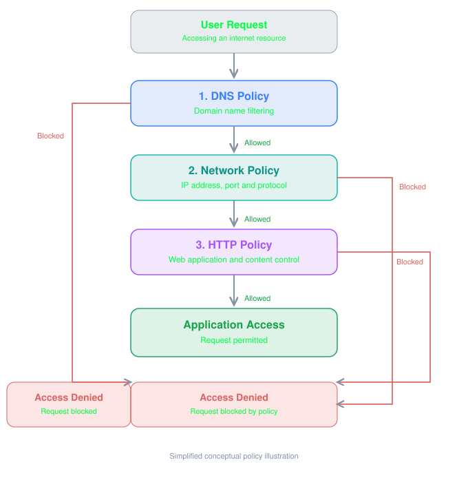

# From Perimeter Security to Zero Trust: Implementing Cloudflare One for Enterprise Traffic Control on

## Implementing Cloudflare One Zero Trust on Windows 11: A Practical Guide to DNS, Network and HTTP Traffic Filtering

**Category:** Network Security | Zero Trust | Cloudflare | Windows Administration

### 1. Introduction

Imagine a company with 100 employees. Some employees work from the office, while others work from home, travel frequently, or connect to the internet from customer locations.

The company has installed a firewall at its office to control internet access. Employees inside the office are protected by this firewall, and the IT team can restrict which websites and services they can access.

But what happens when an employee takes their company laptop home?

The laptop is no longer connected to the office network. It can access the internet through a home router without passing through the company's firewall.

This creates a security problem.

The company can no longer guarantee that its internet access policies are being followed when employees work remotely.

Traditionally, organizations solved this problem by routing remote users through a corporate VPN. However, connecting every remote employee to the internal network just to apply internet security policies is not always necessary.

This is where **Cloudflare One** comes into the picture.

Cloudflare One provides a Zero Trust security platform that allows organizations to apply security policies directly to managed devices, regardless of where those devices are connected.

In this practical guide, we will configure Cloudflare One on a Windows 11 device and understand how it controls internet traffic using three important security layers:

1. DNS Filtering
2. Network Filtering
3. HTTP Filtering

We will also configure TLS inspection and explore how an organization can allow one approved AI application while blocking unauthorized AI services.

By the end of this implementation, we will understand how to move from traditional office-based internet filtering to centralized, location-independent security.

***

### 2. Understanding Cloudflare One and Its Components

Before starting the configuration, let's understand the main components.

Cloudflare One is the centralized security platform. It allows administrators to manage devices, configure security policies, and monitor internet traffic.

However, a Windows computer needs a client application to connect to this platform.

Let's understand the important components.

#### 2.1 Cloudflare One

\<text-placeholder />

Cloudflare One is the central management platform where administrators configure the organization's Zero Trust environment.

From this platform, administrators can:

* Manage registered devices.
* Configure DNS filtering policies.
* Create network security rules.
* Configure HTTP application policies.
* Enable TLS inspection.
* Review security logs.

Think of it as the central control panel for your organization's internet security.

#### 2.2 Cloudflare One Client

Cloudflare One Client is the software installed on the user's computer.

It was previously known as Cloudflare WARP.

The client connects the endpoint to the organization's Cloudflare Zero Trust environment and forwards applicable traffic through the configured secure tunnel.

For example:

An employee working from home opens a browser and visits a website. The Cloudflare One Client helps direct the device's traffic through the organization's Cloudflare security environment, where applicable policies can be enforced.

The important point is that the user does not need to be connected to the office network.

#### 2.3 Cloudflare Gateway

Cloudflare Gateway is responsible for evaluating and enforcing the organization's traffic security policies.

It helps administrators control:

* Which domains users can access.
* Which network destinations and ports are permitted.
* Which web applications employees can use.
* Which AI applications are authorized.

For example, an organization may allow access to Microsoft 365 but block unauthorized file-sharing services.

#### 2.4 MASQUE and WireGuard

These are tunnel protocols used to establish secure connectivity between the endpoint and Cloudflare.

* **MASQUE:** Uses HTTP/3 and QUIC to transport traffic.
* **WireGuard:** Provides an alternative lightweight and secure VPN tunnelling protocol.

The appropriate protocol depends on the organization's network environment and connectivity requirements.

***

### 3. Understanding the Complete Architecture

Before installing anything, let's understand how all the components work together.

Consider an employee using a Windows 11 laptop from home.

The laptop has Cloudflare One Client installed. When the employee accesses the internet, the client establishes connectivity with Cloudflare through a secure tunnel.

Cloudflare Gateway then evaluates applicable traffic against the organization's security policies.

Depending on the request, DNS, Network, or HTTP filtering can be applied.

#### Architecture Diagram

<figure><figcaption></figcaption></figure>

**Figure 1: Cloudflare One Zero Trust architecture for a Windows 11 corporate endpoint.**

#### How does the architecture work?

Let's understand it step by step.

1. The employee opens a Windows 11 laptop.
2. Cloudflare One Client is running in the background.
3. The client establishes a secure connection to Cloudflare.
4. The employee requests access to a website or application.
5. Cloudflare Gateway evaluates the applicable security policies.
6. The request is allowed or blocked according to the configured rules.
7. Relevant activity is recorded in Gateway logs.

The same security approach can be used whether the employee is connected through office Wi-Fi, home broadband, or another supported network.

**Important:** DNS, Network, and HTTP policies operate at different traffic-processing stages. The diagram is a conceptual representation of the security architecture, not a universal packet-processing sequence.

***

### 4. Preparing the Cloudflare Zero Trust Environment

Before installing Cloudflare One Client, we need to prepare the organization.

This is an important step because simply installing the client does not automatically mean that the device is registered with the correct corporate environment.

The administrator must configure the organization's Zero Trust settings.

The preparation includes:

* Creating or accessing the Cloudflare Zero Trust organization.
* Configuring the organization or team name.
* Selecting the authentication method.
* Configuring device enrollment permissions.
* Authorizing the appropriate users to register devices.

#### Why are device enrollment permissions important?

Imagine that the client has been installed successfully, but the employee is not authorized to register a device.

The client may not complete the expected corporate enrollment process.

This is why administrators should verify enrollment permissions before deploying the software to multiple computers.

For an enterprise deployment, device enrollment should be restricted to authorized corporate users.

***

### 5. Installing Cloudflare One Client on Windows 11

Once the organization is ready, the next step is to install Cloudflare One Client on the Windows endpoint.

For a single computer, manual installation may be sufficient.

However, imagine managing 200 or 500 corporate laptops.

Installing and configuring the software manually on every computer would take considerable time.

Therefore, enterprise deployments should use unattended installation.

#### 5.1 What is unattended installation?

Unattended installation means installing software without requiring the user to complete the installation process manually.

The administrator prepares the installation package with the required deployment parameters.

These parameters can configure:

* The organization's Zero Trust registration.
* The required traffic mode.
* DNS traffic routing.
* Automatic reconnection.
* Restrictions preventing users from disabling the client.

PowerShell can be used to automate the installation and deployment process.

#### 5.2 Why should the client not be disabled by users?

Consider this situation:

An organization configures policies to block malicious websites and unauthorized applications.

An employee discovers that the Cloudflare client is running and simply disables it.

The device may then access the internet without the intended corporate filtering.

For managed corporate endpoints, administrators should use the appropriate deployment and device-management controls to prevent unauthorized changes.

#### 5.3 Verify the client connection

After installation, administrators should verify that:

* The client is running.
* The device is registered with the correct organization.
* The correct connection mode is enabled.
* The expected traffic is being routed through the corporate environment.

One important troubleshooting scenario is when the client appears connected but is using the public service rather than the organization's corporate Zero Trust configuration.

In this situation, the device may not receive the expected corporate security policies.

Therefore, always verify the organization registration instead of checking only whether the client displays a connected status.

***

### 6. Understanding MASQUE and WireGuard

After installing the client, we need to understand how it communicates with Cloudflare.

This communication takes place through a secure tunnel.

Cloudflare supports MASQUE and WireGuard as tunnel protocol options.

#### MASQUE

MASQUE uses HTTP/3 and QUIC.

It is designed to work with modern internet transport technologies and can offer better compatibility in certain restrictive network environments.

#### WireGuard

WireGuard is a lightweight VPN protocol designed for secure and efficient communication.

It is known for its relatively simple implementation and strong cryptographic design.

#### Comparison

| Feature               | MASQUE                                     | WireGuard                         |
| --------------------- | ------------------------------------------ | --------------------------------- |
| Transport             | HTTP/3 and QUIC                            | UDP-based tunnel                  |
| Network compatibility | Useful in certain restrictive environments | Depends on UDP connectivity       |
| Performance           | Depends on network conditions              | Designed for efficient tunnelling |
| Use case              | Modern web-compatible tunnelling           | Alternative secure tunnelling     |

The administrator should select the protocol based on network compatibility, security requirements, and organizational policies.

The objective is simple: maintain a reliable and secure connection between the corporate endpoint and Cloudflare.

***

### 7. Understanding the Three Security Policy Layers

This is the most important section of the implementation.

Cloudflare Gateway provides three major policy layers for controlling internet traffic:

1. DNS Policies
2. Network Policies
3. HTTP Policies

Although they all help secure internet access, they work differently.

Let's understand them using simple examples.

#### 7.1 DNS Filtering – Controlling Which Domains Users Can Access

First, let's understand what DNS does.

DNS stands for Domain Name System.

When you enter a website address such as:

`www.example.com`

Your computer needs to resolve that domain into an IP address before connecting to the destination.

DNS filtering allows an organization to control which domain names users can resolve.

For example, suppose an employee attempts to access a known phishing website.

Cloudflare Gateway can evaluate the DNS request and block the domain before the connection is established.

**What can DNS policies do?**

* Block malicious websites.
* Restrict phishing domains.
* Block unwanted website categories.
* Prevent access to selected domains.
* Control domain resolution.

**Real-world example:**

A company wants to prevent employees from accessing known malicious websites.

The administrator creates a DNS filtering policy to block the relevant domains.

When an employee attempts to access one of those websites, the DNS request is blocked according to the configured policy.

**Important limitation:**

DNS filtering primarily identifies domain names.

It cannot reliably identify every application or distinguish between different actions performed inside a website.

For example, allowing a website's domain does not necessarily mean that you can control whether a user uploads a document to that website.

Also, organizations must prevent unauthorized DNS resolver usage if they want DNS filtering to remain effective.

#### 7.2 Network Filtering – Controlling IP Addresses and Ports

DNS filtering controls domain resolution.

But what if we want to control network connections based on IP addresses, ports, or protocols?

This is where Network policies become useful.

Network filtering evaluates network-level information such as:

* Destination IP address.
* Destination port.
* Network protocol.

Let's consider an example.

An organization wants to prevent employees from initiating unauthorized outbound Remote Desktop Protocol connections over TCP port 3389.

The administrator can create an appropriate Network policy to restrict those connections.

At the same time, normal web browsing over permitted HTTPS connections can continue.

**What can Network policies do?**

* Restrict specific ports.
* Block selected IP addresses.
* Control outbound network connections.
* Restrict unauthorized administrative services.
* Apply rules based on network protocols.

**Real-world example:**

An organization does not want regular employees to initiate remote desktop connections to external servers.

The administrator configures a Network policy to block the relevant outbound connections.

Authorized technical users can receive a separate exception according to their requirements.

**Important limitation:**

Network policies do not provide the same application-level visibility as HTTP policies.

For example, they may control a connection to a destination, but they cannot provide granular control over what a user uploads inside a web application.

#### 7.3 HTTP Filtering – Controlling Websites and Applications

Now let's move to the most application-focused layer.

HTTP filtering allows administrators to control web traffic based on supported application and HTTP-related information.

This is particularly useful for modern SaaS applications and AI services.

For example, an organization may allow employees to use Microsoft 365 but block unauthorized AI platforms.

HTTP policies can also support more granular controls depending on the available application and content inspection capabilities.

**What can HTTP policies do?**

* Allow approved web applications.
* Block unauthorized applications.
* Control access to AI services.
* Restrict supported file upload activities.
* Apply controls to web content.
* Help protect sensitive corporate information.

**Real-world example:**

An organization has approved one AI platform for business use.

Employees should be able to access that platform but must not use other unauthorized AI assistants.

The administrator can create application-based HTTP policies to allow the approved service and block the other services.

This is more effective than maintaining a large manual list of website domains.

**Important limitation:**

Most modern websites use HTTPS encryption.

To inspect encrypted web traffic and obtain the required application-level visibility, TLS inspection may need to be enabled.

***

### 8. Understanding the Difference Between DNS, Network and HTTP Policies

Let's compare all three layers in one place.

| Requirement                                   | Appropriate Policy Layer |
| --------------------------------------------- | ------------------------ |
| Block a malicious domain                      | DNS                      |
| Restrict access to a specific domain          | DNS                      |
| Block outbound TCP port 3389                  | Network                  |
| Restrict connections to selected IP addresses | Network                  |
| Allow one approved AI application             | HTTP                     |
| Block unauthorized AI applications            | HTTP                     |
| Control supported document uploads            | HTTP                     |
| Apply supported content inspection rules      | HTTP                     |

#### Visual Summary

<figure><figcaption></figcaption></figure>

**Figure 2: Simplified view of the three policy layers. This is a learning illustration, not a universal processing sequence.**

The most important thing to remember is:

* DNS controls domain resolution.
* Network controls network connections.
* HTTP controls supported web applications and content-related activities.

Always select the policy layer according to the type of control you want to implement.

***

### 9. Understanding Policy Order and Precedence

Creating policies is not enough. We must also understand how their order affects the final decision.

Consider the following example.

An organization creates two HTTP policies:

**Policy 1:** Allow the approved corporate AI application.

**Policy 2:** Block all generative AI applications.

Now imagine that the blocking rule is evaluated before the allow rule.

The approved AI application may also match the broader blocking rule.

As a result, the employee may be unable to access the approved application.

This demonstrates why policy precedence matters.

The administrator must configure the exception and broader blocking rule in the appropriate order according to Cloudflare's policy evaluation behavior.

There may also be interactions between policy layers and specific exceptions that change which rules are evaluated.

**Best practice:** Always verify the actual policy evaluation behavior using Gateway logs. Never assume that a policy is working simply because it appears correctly configured.

***

### 10. Enabling TLS Inspection

Now we come to another important part of the implementation.

Most modern websites use HTTPS.

HTTPS encrypts communication between the browser and the website, protecting information from unauthorized access during transmission.

However, encryption also limits what security systems can inspect.

Consider this example:

An employee accesses an AI website using HTTPS and attempts to upload a confidential company document.

Without appropriate visibility into encrypted traffic, the security platform may not have access to the information needed to enforce the intended content-level policy.

TLS inspection helps address this limitation.

#### 10.1 What is TLS inspection?

TLS inspection allows an authorized security platform to inspect supported encrypted web traffic.

Cloudflare Gateway uses a trusted root CA certificate to establish the necessary certificate trust with managed endpoints.

In simple terms, the Windows computer must trust the certificate used by the inspection system.

#### 10.2 Why do we need a root CA certificate?

When TLS inspection is enabled, the endpoint needs to trust the certificate presented by the inspection system.

If the required certificate is missing or not trusted, the browser may display certificate warnings or applications may fail to establish secure connections.

Therefore, the administrator must deploy the appropriate Cloudflare Gateway root CA certificate to the Windows certificate store.

#### 10.3 Implementation Steps

The general implementation process is:

1. Enable TLS inspection in the Cloudflare Zero Trust environment.
2. Obtain the appropriate Gateway root CA certificate.
3. Deploy the certificate to the Windows endpoint.
4. Verify that Windows trusts the certificate.
5. Test HTTPS websites.
6. Verify that the intended inspection policies are working.

PowerShell can help automate certificate deployment and validation across multiple endpoints.

**Important:** Coordinate certificate deployment with TLS inspection activation. Follow the documented deployment sequence and test the configuration before rolling it out across the organization.

Some applications use certificate pinning or other security mechanisms that may not work with TLS inspection. These applications may require specific exclusions or alternative controls.

***

### 11. Practical Enterprise Scenario: Allow One AI Application and Block the Rest

Let's now apply what we have learned to a real business problem.

#### Business Requirement

A company wants employees to use AI tools to improve productivity.

However, management is concerned that employees may submit confidential information to unauthorized external AI platforms.

The company decides to approve one AI platform for business use.

All other AI services must be blocked.

#### Proposed Security Architecture

<figure><figcaption></figcaption></figure>

**Figure 3: AI application access control using Cloudflare Gateway.**

#### Step 1: Identify the Approved AI Platform

The organization selects its authorized AI platform.

The administrator verifies that the application is supported by the relevant Cloudflare application identification and policy capabilities.

#### Step 2: Create an Allow Policy

Create an HTTP policy that allows access to the approved AI application.

The policy should apply to the appropriate corporate users or device groups.

#### Step 3: Create a Blocking Policy

Create another HTTP policy to block the broader generative AI application category.

This helps prevent employees from accessing unauthorized AI services.

#### Step 4: Configure Policy Precedence

The approved AI exception must take precedence over the broader blocking rule according to the configured policy evaluation behavior.

This is the most important part of the implementation.

#### Step 5: Test the Configuration

Use the Windows 11 endpoint to perform the following tests:

| Test                            | Expected Result                  |
| ------------------------------- | -------------------------------- |
| Open the approved AI platform   | Access allowed                   |
| Open another AI assistant       | Access blocked                   |
| Open an unauthorized AI service | Access blocked                   |
| Review Gateway logs             | Relevant policy decision visible |

This provides a practical way to control AI adoption without blocking all AI technology.

***

### 12. Moving Beyond AI Blocking: Protecting Corporate Data

Allowing one approved AI platform and blocking other services is a good starting point.

However, there is another important security question:

**What happens if an employee uploads a confidential company document to the approved AI platform?**

Allowing an application does not automatically mean that every action performed inside it should be permitted.

A more mature security configuration should consider:

* Allowing access to the approved AI platform.
* Restricting supported document uploads.
* Detecting or preventing the submission of sensitive information.
* Applying appropriate data protection policies.
* Recording relevant security events.

For example, the organization may allow employees to use an approved AI platform for general research but restrict uploading confidential business documents.

This approach provides a balance between productivity and security.

Instead of completely blocking AI, the organization controls how it is used.

***

### 13. Enterprise Implementation and Validation Checklist

Before deploying the configuration across all corporate devices, the IT team should validate each component.

| No. | Validation Activity                | Expected Result                         |
| --- | ---------------------------------- | --------------------------------------- |
| 1   | Verify Cloudflare One organization | Correct organization configured         |
| 2   | Verify device enrollment           | Windows device registered               |
| 3   | Verify client status               | Client connected correctly              |
| 4   | Verify traffic routing             | Corporate traffic follows intended path |
| 5   | Test DNS filtering                 | Restricted domains blocked              |
| 6   | Test Network filtering             | Unauthorized ports restricted           |
| 7   | Test normal browsing               | Authorized websites accessible          |
| 8   | Verify root CA certificate         | Certificate trusted by Windows          |
| 9   | Test TLS inspection                | Supported encrypted traffic inspected   |
| 10  | Test approved AI application       | Access allowed                          |
| 11  | Test unauthorized AI applications  | Access blocked                          |
| 12  | Review Gateway logs                | Policy decisions recorded               |

Testing should be performed one layer at a time.

For example, if a website is accessible even though it should be blocked, first verify whether the endpoint is using the correct corporate configuration.

Then check the applicable policy, its precedence, and the Gateway logs.

This approach makes troubleshooting easier and avoids unnecessary configuration changes.

***

### 14. Security Considerations and Best Practices

Although Cloudflare One provides centralized traffic security, organizations must configure and manage it properly.

Consider the following recommendations.

#### 14.1 Protect Device Enrollment

Only authorized users should be allowed to register corporate devices.

#### 14.2 Prevent Unauthorized Client Changes

Use appropriate device-management controls to prevent users from disabling or modifying the security client.

#### 14.3 Prevent DNS Bypass

Restrict unauthorized external DNS resolution so users cannot easily bypass domain filtering.

#### 14.4 Test Policy Precedence

Always verify allow and block rules, especially when creating exceptions.

#### 14.5 Deploy TLS Certificates Carefully

Test certificate deployment and encrypted traffic inspection before organization-wide deployment.

#### 14.6 Monitor Security Logs

Regularly review Gateway logs to identify blocked connections, policy violations, and unusual activity.

#### 14.7 Consider Employee Privacy

TLS inspection provides additional visibility into user traffic.

Organizations should review applicable data protection requirements, communicate inspection practices to employees, and define appropriate logging and retention policies.

#### 14.8 Plan for Exceptions

Some applications may not work correctly with TLS inspection. Identify these applications and define appropriate exceptions without weakening the overall security policy.

***

### 15. Expected Business Benefits

After successfully implementing Cloudflare One, the organization can achieve several benefits.

**Location-independent security**

Security policies can follow managed devices regardless of whether employees work from the office or remotely.

**Centralized traffic management**

Administrators can manage traffic security policies through a central platform.

**Better application visibility**

Organizations can identify and control supported web applications.

**Controlled AI adoption**

Employees can use approved AI services while unauthorized services are restricted.

**Improved data protection**

Supported content inspection and data protection policies can help reduce the risk of sensitive information being shared externally.

**Reduced dependency on traditional perimeter filtering**

Organizations can enforce endpoint-based security without requiring every internet request to pass through the physical office firewall.

**Better security monitoring**

Gateway logs provide visibility into policy enforcement and support incident investigation.

***

### 16. Conclusion

Traditional firewall-based security was designed around a time when most employees worked from the office.

Today, employees connect from different locations, networks, and devices. This makes it increasingly important to move security controls closer to the endpoint.

Cloudflare One provides a way to achieve this through its centralized Zero Trust platform, endpoint client, and Gateway security policies.

In this implementation, we explored three important filtering layers:

* DNS policies for controlling domain resolution.
* Network policies for controlling IP addresses, ports, and protocols.
* HTTP policies for controlling supported web applications and content-related activities.

We also explored TLS inspection, certificate deployment, secure tunnelling, and a practical enterprise use case involving generative AI application control.

The biggest lesson is that modern security is not simply about blocking everything.

It is about allowing employees to access the services they need while controlling unauthorized activity and protecting corporate information.

For organizations adopting hybrid work and AI technologies, Cloudflare One provides a practical foundation for building a more flexible and centralized Zero Trust security architecture.

***

### Technical Demonstration Summary

This practical implementation covers:

1. Preparing the Cloudflare Zero Trust organization.
2. Configuring device enrollment permissions.
3. Installing Cloudflare One Client on Windows 11.
4. Understanding MASQUE and WireGuard.
5. Configuring DNS filtering policies.
6. Configuring Network filtering policies.
7. Configuring HTTP application policies.
8. Enabling TLS inspection.
9. Deploying the Gateway root CA certificate.
10. Allowing an approved AI application.
11. Blocking unauthorized AI applications.
12. Validating policies and reviewing Gateway logs.

**Final takeaway:** Secure the device, control the traffic, monitor the activity, and protect the data — regardless of where the employee is working.

***

## REFERENCES

* [https://developers.cloudflare.com/cloudflare-one/traffic-controls/](https://developers.cloudflare.com/cloudflare-one/traffic-controls/)
