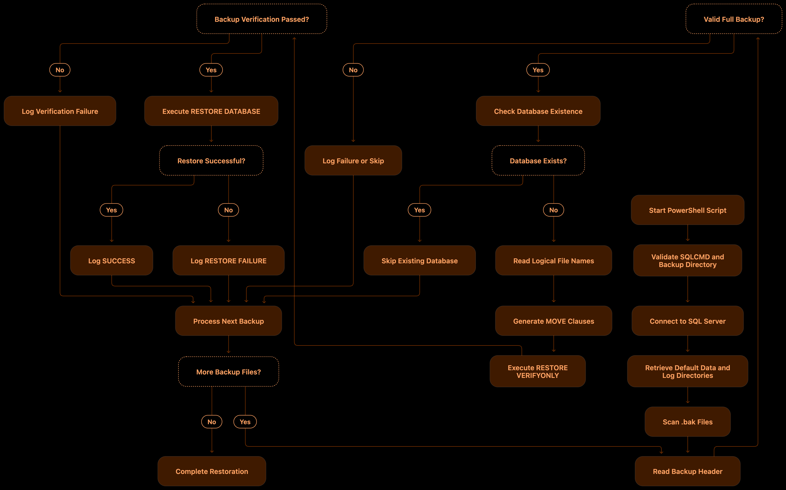

# Automated Bulk Microsoft SQL Server Database Restoration

## Automated Bulk Microsoft SQL Server Database Restoration Using PowerShell

### 1. Introduction

Restoring multiple Microsoft SQL Server databases individually can be time-consuming, especially when managing hosting environments containing dozens or hundreds of customer databases.

This PowerShell automation script simplifies the process by automatically detecting `.bak` files in a specified directory, identifying their database names and logical files, validating backup integrity, and restoring databases to a local SQL Server instance.

The script is designed with a non-overwrite approach: if a database already exists on the SQL Server instance, it skips that database instead of replacing its existing data.

It is particularly useful for Windows Server administrators, database administrators, and hosting engineers performing bulk SQL Server database migrations or restorations.

### 2. Script Overview

| Parameter                  | Configuration          |
| -------------------------- | ---------------------- |
| Automation Tool            | Windows PowerShell     |
| Database Engine            | Microsoft SQL Server   |
| SQL Instance               | `localhost`            |
| Backup Directory           | `C:\sql-backup29-10`   |
| Backup Format              | `.bak`                 |
| Authentication             | Windows Authentication |
| SQL Command Utility        | SQLCMD                 |
| Restore Mode               | Full Database Restore  |
| Existing Database Handling | Skip                   |
| Backup Verification        | RESTORE VERIFYONLY     |
| Restore Progress           | STATS = 10             |
| Logging                    | Timestamped text log   |

### 3. Key Features

#### Automated backup detection

* Scans the configured backup directory.
* Identifies all `.bak` files.
* Ignores empty backup files.
* Processes backups alphabetically.

#### Existing database protection

Before restoring a database, the script checks whether its database name already exists.

* Existing databases are skipped.
* No existing database is overwritten.
* New databases are restored automatically.

#### Automatic logical file detection

SQL Server backups may contain multiple database files, including:

* Primary data files (`.mdf`)
* Secondary data files (`.ndf`)
* Transaction log files (`.ldf`)

The script reads logical file information using `RESTORE FILELISTONLY` and generates the necessary `MOVE` clauses.

#### Backup integrity verification

Before restoring a database, the script executes:

```
RESTORE VERIFYONLY
FROM DISK = 'C:\sql-backup29-10\DatabaseName.bak';
```

This checks whether SQL Server can read and validate the backup set.

#### Automatic directory mapping

The script retrieves SQL Server's default data and log directories using `SERVERPROPERTY()`.

It then generates destination paths for the restored database files.

#### Restore logging

A timestamped log file is generated inside the backup directory.

Example:

`RestoreLog_20261101_213000.txt`

The log records successful restorations, skipped databases, and failures.

### 4. Execution Workflow

The automation follows this sequence:


<figure><figcaption></figcaption></figure>

### 5. Prerequisites

Before executing the script, ensure the following requirements are met.

1. Windows Server with Microsoft SQL Server installed.
2. SQL Server Database Engine service running.
3. SQLCMD utility installed.
4. Backup files available in `C:\sql-backup29-10`.
5. Windows account has sufficient SQL Server permissions, typically `sysadmin` for this workflow.
6. SQL Server service account has read access to the backup directory.
7. SQL Server service account has write permissions on the destination data and log directories.
8. Sufficient disk space is available for all database files.

Important: The SQL Server service account accesses the `.bak` files, not necessarily the Windows account executing PowerShell.

### 6. Complete PowerShell Script

The following is the complete script, consolidated into a single code pane for easy copying and deployment.

```ps1

# ============================================================
# RESTORE ALL MSSQL DATABASE BACKUPS
#
# Source       : C:\sql-backup29-10
# SQL Instance : localhost
# Existing databases are skipped
# ============================================================

$BackupPath = "C:\sql-backup29-10"
$SqlInstance = "localhost"
$SqlCmd = "C:\Program Files\Microsoft SQL Server\Client SDK\ODBC\130\Tools\Binn\SQLCMD.EXE"

$Timestamp = Get-Date -Format "yyyyMMdd_HHmmss"
$LogFile = Join-Path $BackupPath "RestoreLog_$Timestamp.txt"

# ------------------------------------------------------------
# Validate configuration
# ------------------------------------------------------------

if (-not (Test-Path $SqlCmd)) {
    Write-Host "ERROR: sqlcmd.exe not found." -ForegroundColor Red
    return
}

if (-not (Test-Path $BackupPath)) {
    Write-Host "ERROR: Backup folder not found." -ForegroundColor Red
    return
}

$BackupFiles = @(Get-ChildItem -Path $BackupPath -Filter "*.bak" -File |
    Where-Object { $_.Length -gt 0 } |
    Sort-Object Name)

if ($BackupFiles.Count -eq 0) {
    Write-Host "No backup files found." -ForegroundColor Yellow
    return
}

# ------------------------------------------------------------
# Verify SQL connection
# ------------------------------------------------------------

& $SqlCmd -S $SqlInstance -E -b -Q "SELECT @@SERVERNAME;"

if ($LASTEXITCODE -ne 0) {
    Write-Host "ERROR: SQL Server connection failed." -ForegroundColor Red
    return
}

# ------------------------------------------------------------
# Get SQL Server default data and log directories
# ------------------------------------------------------------

$DataDirQuery = "SET NOCOUNT ON; SELECT CAST(SERVERPROPERTY('InstanceDefaultDataPath') AS nvarchar(4000));"
$LogDirQuery = "SET NOCOUNT ON; SELECT CAST(SERVERPROPERTY('InstanceDefaultLogPath') AS nvarchar(4000));"

$DataDir = (& $SqlCmd -S $SqlInstance -E -h -1 -W -Q $DataDirQuery 2>$null |
    Where-Object { "$_".Trim() } | Select-Object -First 1)

$LogDir = (& $SqlCmd -S $SqlInstance -E -h -1 -W -Q $LogDirQuery 2>$null |
    Where-Object { "$_".Trim() } | Select-Object -First 1)

if ([string]::IsNullOrWhiteSpace("$DataDir")) {
    $DataDir = (& $SqlCmd -S $SqlInstance -E -h -1 -W -Q `
        "SET NOCOUNT ON; SELECT LEFT(physical_name,LEN(physical_name)-CHARINDEX('\',REVERSE(physical_name))+1) FROM sys.master_files WHERE database_id=1 AND file_id=1;" 2>$null |
        Where-Object { "$_".Trim() } | Select-Object -First 1)
}

if ([string]::IsNullOrWhiteSpace("$LogDir")) {
    $LogDir = $DataDir
}

$DataDir = "$DataDir".Trim()
$LogDir = "$LogDir".Trim()

if (-not $DataDir -or -not $LogDir) {
    Write-Host "ERROR: Could not determine SQL Server data/log directories." -ForegroundColor Red
    return
}

Write-Host "SQL Instance : $SqlInstance"
Write-Host "Data folder  : $DataDir"
Write-Host "Log folder   : $LogDir"
Write-Host "Backup count : $($BackupFiles.Count)"

Add-Content -Path $LogFile -Value "Restore started: $(Get-Date)"

# ------------------------------------------------------------
# Process each backup
# ------------------------------------------------------------

foreach ($Backup in $BackupFiles) {

    $BackupFile = $Backup.FullName
    $EscapedBackupFile = $BackupFile.Replace("'", "''")

    Write-Host "`nInspecting: $($Backup.Name)" -ForegroundColor Cyan

    # Read backup header without column headings

    $HeaderOutput = @(& $SqlCmd -S $SqlInstance -E -b `
        -h -1 -W -s "|" `
        -Q "SET NOCOUNT ON; RESTORE HEADERONLY FROM DISK=N'$EscapedBackupFile';" 2>&1)

    if ($LASTEXITCODE -ne 0) {
        $Message = "FAILED: Cannot read backup header: $BackupFile"
        Write-Host $Message -ForegroundColor Red
        Add-Content -Path $LogFile -Value $Message
        continue
    }

    # Locate the header row using its numeric backup position

    $HeaderRow = $null

    foreach ($Line in $HeaderOutput) {
        $Fields = "$Line" -split "\|"

        if ($Fields.Count -ge 10 -and
            $Fields[5].Trim() -match '^\d+$' -and
            $Fields[9].Trim() -ne "") {
            $HeaderRow = $Fields
            break
        }
    }

    if (-not $HeaderRow) {
        $Message = "FAILED: Could not parse backup metadata: $BackupFile"
        Write-Host $Message -ForegroundColor Red
        Add-Content -Path $LogFile -Value $Message
        continue
    }

    $BackupType = $HeaderRow[2].Trim()
    $Position = $HeaderRow[5].Trim()
    $DBName = $HeaderRow[9].Trim()

    if ($BackupType -ne "1" -or $Position -notmatch '^\d+$' -or -not $DBName) {
        $Message = "SKIPPED: Not a recognized full database backup: $BackupFile"
        Write-Host $Message -ForegroundColor Yellow
        Add-Content -Path $LogFile -Value $Message
        continue
    }

    $EscapedDB = $DBName.Replace("'", "''")
    $EscapedIdentifier = $DBName.Replace("]", "]]")

    # Never overwrite an existing database

    $ExistsQuery = "SET NOCOUNT ON; SELECT CASE WHEN DB_ID(N'$EscapedDB') IS NULL THEN 0 ELSE 1 END;"

    $ExistsOutput = & $SqlCmd -S $SqlInstance -E -b -h -1 -W `
        -Q $ExistsQuery 2>&1

    if ($LASTEXITCODE -ne 0) {
        $Message = "FAILED: Cannot check database: $DBName"
        Write-Host $Message -ForegroundColor Red
        Add-Content -Path $LogFile -Value $Message
        continue
    }

    if ("$ExistsOutput".Trim() -eq "1") {
        $Message = "SKIPPED: Database already exists: $DBName"
        Write-Host $Message -ForegroundColor Yellow
        Add-Content -Path $LogFile -Value $Message
        continue
    }

    # Read logical file names and file types

    $FileListQuery = "SET NOCOUNT ON; RESTORE FILELISTONLY FROM DISK=N'$EscapedBackupFile' WITH FILE=$Position;"

    $FileListOutput = @(& $SqlCmd -S $SqlInstance -E -b `
        -h -1 -W -s "|" -Q $FileListQuery 2>&1)

    if ($LASTEXITCODE -ne 0) {
        $Message = "FAILED: Cannot read logical files: $BackupFile"
        Write-Host $Message -ForegroundColor Red
        Add-Content -Path $LogFile -Value $Message
        continue
    }

    $LogicalFiles = @()

    foreach ($Line in $FileListOutput) {
        $Fields = "$Line" -split "\|"

        # RESTORE FILELISTONLY: LogicalName, PhysicalName, Type,
        # FileGroupName, Size, MaxSize, FileId, ...

        if ($Fields.Count -ge 7 -and
            $Fields[2].Trim() -match '^(D|L|F|S|X)$' -and
            $Fields[6].Trim() -match '^\d+$' -and
            $Fields[0].Trim() -ne "") {

            $LogicalFiles += [PSCustomObject]@{
                LogicalName = $Fields[0].Trim()
                FileType    = $Fields[2].Trim()
                FileId      = [int]$Fields[6].Trim()
            }
        }
    }

    if ($LogicalFiles.Count -eq 0) {
        $Message = "FAILED: No logical files were parsed from $BackupFile"
        Write-Host $Message -ForegroundColor Red
        Add-Content -Path $LogFile -Value $Message
        continue
    }

    # Build MOVE clauses for all files in the backup

    $MoveClauses = @()
    $SafeDBName = $DBName -replace '[\\/:*?"<>|]', '_'
    $FileNumber = 0
    $FileMappingFailed = $false

    foreach ($LogicalFile in $LogicalFiles) {
        $FileNumber++

        $SafeLogicalName = $LogicalFile.LogicalName -replace '[\\/:*?"<>|]', '_'

        switch ($LogicalFile.FileType) {
            "D" {
                if ($LogicalFile.FileId -eq 1) {
                    $Extension = ".mdf"
                }
                else {
                    $Extension = ".ndf"
                }
                $TargetDirectory = $DataDir
            }

            "L" {
                $Extension = ".ldf"
                $TargetDirectory = $LogDir
            }

            default {
                $Message = "SKIPPED: Unsupported file type $($LogicalFile.FileType) in $DBName. No files restored."
                Write-Host $Message -ForegroundColor Yellow
                Add-Content -Path $LogFile -Value $Message
                $FileMappingFailed = $true
                break
            }
        }

        if ($FileMappingFailed) {
            break
        }

        $DestinationFile = Join-Path $TargetDirectory "${SafeDBName}_${FileNumber}_${SafeLogicalName}${Extension}"
        $EscapedLogical = $LogicalFile.LogicalName.Replace("'", "''")
        $EscapedDestination = $DestinationFile.Replace("'", "''")

        $MoveClauses += "MOVE N'$EscapedLogical' TO N'$EscapedDestination'"
    }

    if ($FileMappingFailed -or $MoveClauses.Count -ne $LogicalFiles.Count) {
        continue
    }

    # Verify backup before restoring

    $VerifyQuery = "RESTORE VERIFYONLY FROM DISK=N'$EscapedBackupFile' WITH FILE=$Position;"

    & $SqlCmd -S $SqlInstance -E -b -t 0 -Q $VerifyQuery

    if ($LASTEXITCODE -ne 0) {
        $Message = "FAILED: Backup verification failed: $DBName"
        Write-Host $Message -ForegroundColor Red
        Add-Content -Path $LogFile -Value $Message
        continue
    }

    # Restore database

    $RestoreQuery = @"
RESTORE DATABASE [$EscapedIdentifier]
FROM DISK = N'$EscapedBackupFile'
WITH FILE = $Position,
     $($MoveClauses -join ",`r`n     "),
     RECOVERY,
     STATS = 10;
"@

    Write-Host "Restoring database: $DBName" -ForegroundColor Cyan

    & $SqlCmd -S $SqlInstance -E -b -t 0 -Q $RestoreQuery

    if ($LASTEXITCODE -eq 0) {
        $Message = "SUCCESS: Restored $DBName from $BackupFile"
        Write-Host $Message -ForegroundColor Green
    }
    else {
        $Message = "FAILED: Restore failed for $DBName. Check SQL Server error output."
        Write-Host $Message -ForegroundColor Red
    }

    Add-Content -Path $LogFile -Value $Message
}

Write-Host "`nRestore process completed." -ForegroundColor Green
Write-Host "Backup folder: $BackupPath"
Write-Host "Log file: $LogFile"
```

### 7. How to Execute the Script

Step 1: Prepare the backup directory

Create the following directory and place all database backup files inside it:

```
C:\sql-backup29-10
```

Step 2: Save the PowerShell script

Save the script as:

```
Restore-All-MSSQL-Databases.ps1
```

Step 3: Open PowerShell as Administrator

Navigate to the directory where the script is saved.

Step 4: Execute the script

```
Set-ExecutionPolicy -Scope Process -ExecutionPolicy Bypass

.\Restore-All-MSSQL-Databases.ps1
```

Step 5: Monitor restoration

The console displays the restoration progress, including:

* Backup files being inspected.
* Existing databases being skipped.
* Backup verification results.
* Database restoration progress.
* Successful and failed operations.

### 8. Expected Output

Example console output:

```
SQL Instance : localhost
Data folder  : C:\Program Files\Microsoft SQL Server\MSSQL15.MSSQLSERVER\MSSQL\DATA\
Log folder   : C:\Program Files\Microsoft SQL Server\MSSQL15.MSSQLSERVER\MSSQL\DATA\
Backup count : 25

Inspecting: Database1.bak
SKIPPED: Database already exists: Database1

Inspecting: Database2.bak
Restoring database: Database2
10 percent processed.
20 percent processed.
30 percent processed.
100 percent processed.

SUCCESS: Restored Database2

Inspecting: Database3.bak
SUCCESS: Restored Database3

Restore process completed.
```

Output is illustrative; actual database names, paths, and progress depend on the SQL Server environment.

### 9. Important Technical Considerations

Before deploying this script in a production environment, consider the following:

| Area               | Consideration                                                                            |
| ------------------ | ---------------------------------------------------------------------------------------- |
| Backup format      | Only recognized full database backup sets are processed.                                 |
| Existing databases | Existing databases are skipped, not overwritten.                                         |
| Backup integrity   | `VERIFYONLY` does not replace a complete test restore or `DBCC CHECKDB`.                 |
| SQL permissions    | The executing account requires appropriate restore permissions.                          |
| File permissions   | SQL Server service account requires access to source and destination paths.              |
| Backup devices     | The current script expects individual `.bak` files.                                      |
| File types         | The script currently supports standard data and log files; other file types are skipped. |
| Recovery           | Databases are restored using `RECOVERY`.                                                 |

One important limitation in the current implementation: The script parses `RESTORE HEADERONLY` and `RESTORE FILELISTONLY` output using pipe-separated text. Logical names or metadata containing pipe characters can interfere with parsing. Also, backup files containing multiple backup sets are not exhaustively examined; the script uses the first recognized full backup header.

For production-grade deployment, structured SQL metadata handling and destination-file collision checks would make the automation more reliable.

### 10. Conclusion

This PowerShell automation provides a practical approach to bulk SQL Server database restoration without manually restoring each `.bak` file through SQL Server Management Studio.

Its main advantages are:

* Automated backup discovery.
* Automatic database name detection.
* Dynamic logical file mapping.
* Backup verification before restoration.
* Protection against overwriting existing databases.
* Centralized restoration logging.
* Automated processing of multiple databases.

It can be particularly useful during hosting server migrations, database recovery operations, and Windows-based SQL Server administration.

