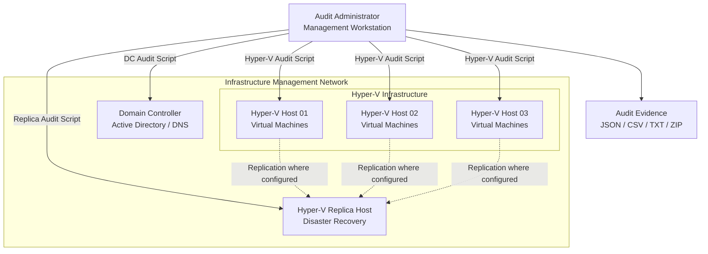

# Building a Server Infrastructure Audit Framework Using PowerShell

### Automating Infrastructure Assessment and Evidence Collection Across Windows Server and Hyper-V Environments

#### Introduction

Infrastructure auditing is an essential part of maintaining a secure, reliable, and well-managed IT environment. Organizations depend on Windows Server, Active Directory, DNS, Hyper-V virtualization, and disaster recovery infrastructure to support their daily operations.

However, collecting infrastructure information manually can be time-consuming. Administrators often need to connect to multiple servers, execute different PowerShell commands, gather configuration details, review event logs, and organize the collected information into audit reports.

To simplify this process, I developed a **Server Infrastructure Audit Framework using PowerShell**.

The project is designed to automate infrastructure information collection, standardize audit evidence, and provide a reusable foundation for assessing Windows Server and Hyper-V environments.

### 1. Project Objectives

The primary objective is to reduce repetitive manual audit activities and establish a structured approach to infrastructure evidence collection.

The framework focuses on:

* Collecting Windows Server configuration and health information.
* Auditing Active Directory and DNS-related information.
* Gathering Hyper-V host configuration and virtual machine inventory.
* Reviewing Hyper-V Replica configuration and status where applicable.
* Generating structured evidence in JSON, CSV, and text formats.
* Organizing collected information for technical review and audit reporting.

The framework is modular, allowing additional infrastructure audit scripts to be introduced as the project evolves.

### 2. Infrastructure Architecture

The framework is designed around a typical Windows infrastructure environment consisting of a Domain Controller, multiple Hyper-V hosts, and a dedicated disaster recovery host.

#### Reference Architecture



The audit administrator executes the relevant scripts against the authorized infrastructure systems. Each script collects information related to its designated infrastructure component and generates evidence for subsequent review.

_Note: This is a logical reference architecture. Replication relationships must be independently verified in the target environment._

### 3. Technology Stack

The project uses the following technologies:

| Technology       | Purpose                                               |
| ---------------- | ----------------------------------------------------- |
| PowerShell       | Infrastructure information collection and automation  |
| Windows Server   | Target operating system for infrastructure assessment |
| Active Directory | Directory services assessment                         |
| DNS              | DNS configuration information collection              |
| Hyper-V          | Virtualization infrastructure assessment              |
| JSON             | Structured evidence storage                           |
| CSV              | Tabular inventory and configuration data              |
| GitHub           | Source code management and version control            |

PowerShell was selected because it provides native access to Windows administration capabilities and infrastructure management modules.

### 4. Main Audit Modules

The framework is organized into separate modules to make the collection process easier to maintain and extend.

#### Module 1: Domain Controller Audit

Script:

`DC-Server-Audit.ps1`

The Domain Controller audit module is intended to collect information related to:

* Windows Server operating system details.
* Active Directory configuration.
* DNS information.
* Windows services.
* Security-related configuration.
* Relevant Windows event logs.

This information helps administrators understand the current configuration of the Domain Controller and identify areas requiring further investigation.

#### Module 2: Hyper-V Host Audit

Script:

`HyperV-Host-Audit.ps1`

Hyper-V environments can contain multiple virtualization hosts, each running several virtual machines.

Manually collecting information from every host can become difficult, particularly in environments with a large number of virtual machines.

The Hyper-V audit module is designed to collect:

* Hyper-V host information.
* Virtual machine inventory.
* VM configuration details.
* Virtual switch information.
* Storage-related information.
* Host configuration and health information.
* Selected event-log information.

Each Hyper-V host can be assessed independently, allowing administrators to consolidate the collected evidence across the virtualization environment.

#### Module 3: Hyper-V Replica and Disaster Recovery Audit

Script:

`HyperV-Replica-Audit.ps1`

Disaster recovery is an important component of infrastructure availability.

The Replica audit module is designed to inspect Hyper-V Replica configuration and collect replication-related information where the feature is configured and accessible.

The collected information can support reviews of:

* Hyper-V Replica configuration.
* Replication status.
* Replication-related settings.
* Recovery-related information.
* Collection errors and unavailable data.

It is important to distinguish between Hyper-V Replica and third-party replication or backup products. A Hyper-V Replica query cannot independently establish the health of another disaster recovery solution.

### 5. Evidence Collection and Output Structure

One of the important design considerations was to organize collected information in formats that can be easily reviewed and processed.

The framework is intended to generate different evidence formats depending on the audit requirement.

| Format | Purpose                                         |
| ------ | ----------------------------------------------- |
| JSON   | Structured configuration and system information |
| CSV    | Inventory and tabular records                   |
| TXT    | Readable command output and summaries           |
| ZIP    | Packaging collected evidence for review         |

A structured evidence collection process makes it easier to:

1. Identify the source server.
2. Review collected configuration information.
3. Compare infrastructure components.
4. Investigate collection errors.
5. Reference supporting evidence while preparing audit reports.

Collection errors should be documented separately and should not automatically be treated as confirmed infrastructure failures.

### 6. Repository Structure

The project follows a modular directory structure.

```
Server-Infrastructure-Audit/
│
├── Scripts/
│   ├── Domain-Controller/
│   │   └── DC-Server-Audit.ps1
│   │
│   ├── Hyper-V/
│   │   └── HyperV-Host-Audit.ps1
│   │
│   ├── Disaster-Recovery/
│   │   └── HyperV-Replica-Audit.ps1
│   │
│   └── Common/
│
├── Documentation/
├── Architecture/
├── Tests/
├── Output/
│
├── README.md
├── CHANGELOG.md
├── CONTRIBUTING.md
└── LICENSE
```

This structure separates scripts according to their responsibilities and provides dedicated locations for documentation, architecture references, testing notes, and generated output.

### 7. How to Use the Framework

The general execution process is straightforward.

#### Step 1: Prepare the audit environment

* Clone or download the repository.
* Use an authorized Windows management workstation.
* Confirm PowerShell and required management modules.
* Verify the permissions needed for the selected audit scripts.

#### Step 2: Select the audit module

Choose the script according to the infrastructure component being assessed.

#### Step 3: Execute the script

For example, to execute the Hyper-V host audit:

```
Set-Location "C:\Path\To\Server-Infrastructure-Audit"

.\Scripts\Hyper-V\HyperV-Host-Audit.ps1
```

To execute the Domain Controller audit:

```
.\Scripts\Domain-Controller\DC-Server-Audit.ps1
```

To execute the Hyper-V Replica audit:

```
.\Scripts\Disaster-Recovery\HyperV-Replica-Audit.ps1
```

These are example commands. Check each script's parameters and documentation before execution.

#### Step 4: Review the collected evidence

After execution, inspect the generated output files.

Verify:

* Whether the expected evidence files were created.
* Whether the collected information is complete.
* Whether any commands returned errors.
* Whether the collected information matches the target infrastructure.

#### Step 5: Prepare the audit report

Use the collected evidence as supporting material for infrastructure observations, configuration reviews, and audit reporting.

### 8. Practical Benefits

The framework is intended to provide several operational benefits.

**Reduced manual effort:** Administrators can automate repetitive information collection instead of manually executing individual commands on every server.

**Standardized evidence:** Structured output makes information easier to organize and review.

**Modular design:** Separate scripts make it easier to maintain and expand the framework.

**Improved audit preparation:** Consistent evidence collection helps support technical assessments and reporting.

**Reusable across environments:** The reference architecture and modular approach can be adapted to different Windows Server and Hyper-V environments.

These benefits depend on appropriate script validation, permissions, and the completeness of the implemented checks.

### 9. Security and Validation Considerations

Infrastructure audit scripts should be treated as privileged administrative tools, even when their intended purpose is read-only collection.

Before using the framework in production:

* Review the PowerShell source code.
* Test the scripts in a representative lab.
* Confirm compatibility with the target Windows Server and PowerShell versions.
* Use least-privilege permissions wherever possible.
* Protect collected evidence because it may contain sensitive infrastructure information.
* Do not store credentials or customer-specific information in public repositories.
* Validate important observations directly against the target systems.

A successful script execution does not necessarily mean that every audit check returned complete information. Technical review and evidence validation remain necessary.

### 10. Future Enhancements

The framework provides a foundation for additional infrastructure assessment capabilities.

Potential future improvements include:

* Windows Server security baseline assessment.
* Group Policy configuration assessment.
* Windows Firewall configuration review.
* IIS web server auditing.
* Windows Failover Cluster assessment.
* Storage and backup configuration auditing.
* Certificate and PKI assessment.
* Automated HTML audit reports.
* Centralized evidence consolidation.
* PowerShell-based configuration comparison.
* Automated script validation and testing.

These are planned enhancement areas rather than claims about existing functionality.

### Conclusion

Building this Server Infrastructure Audit Framework has been an opportunity to combine Windows Server administration, PowerShell automation, virtualization management, and infrastructure auditing into a reusable technical project.

The goal is not simply to execute PowerShell commands, but to create a consistent process for collecting, organizing, and reviewing infrastructure evidence.

By separating the audit modules, standardizing the output structure, and maintaining the project through GitHub, the framework can continue to evolve as additional infrastructure assessment requirements are introduced.

**Project Repository:** [Server Infrastructure Audit Framework](https://github.com/3ls3if/Server-Infrastructure-Audit)

_This project is intended for authorized infrastructure assessment and technical audit evidence collection. Always validate scripts in a test environment before production use._
