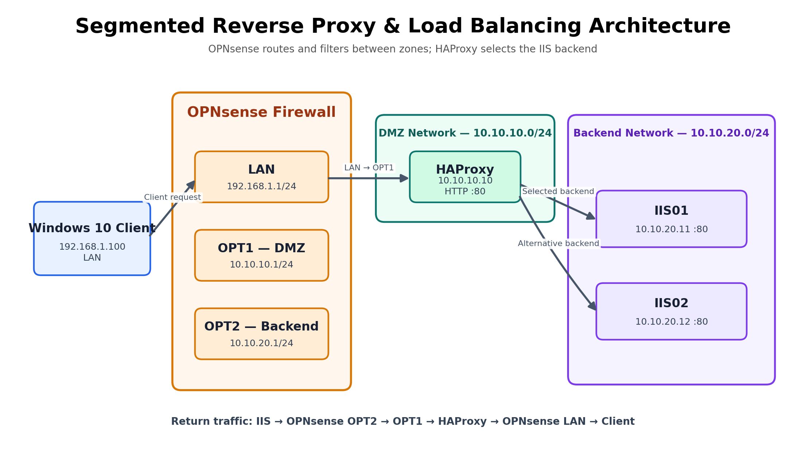
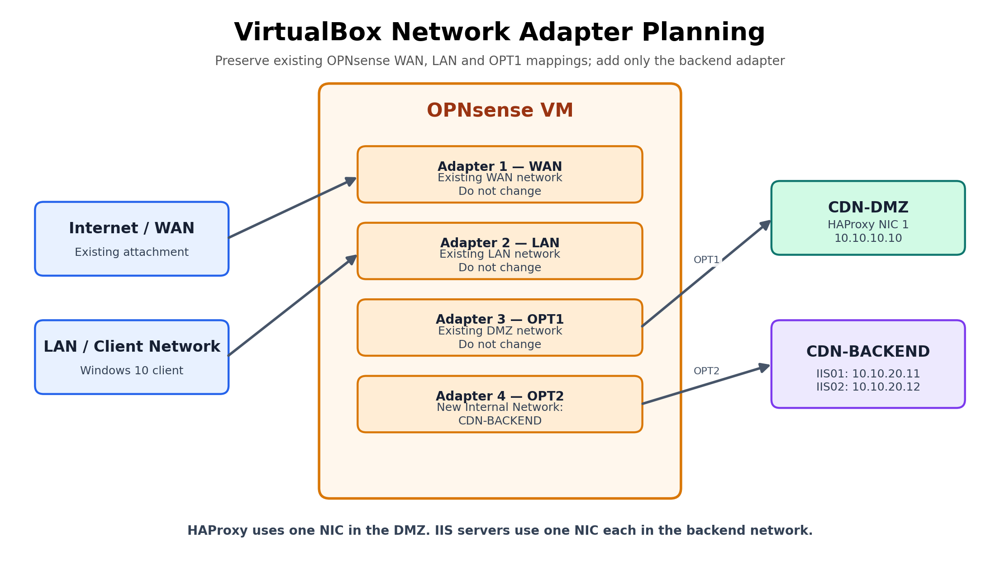
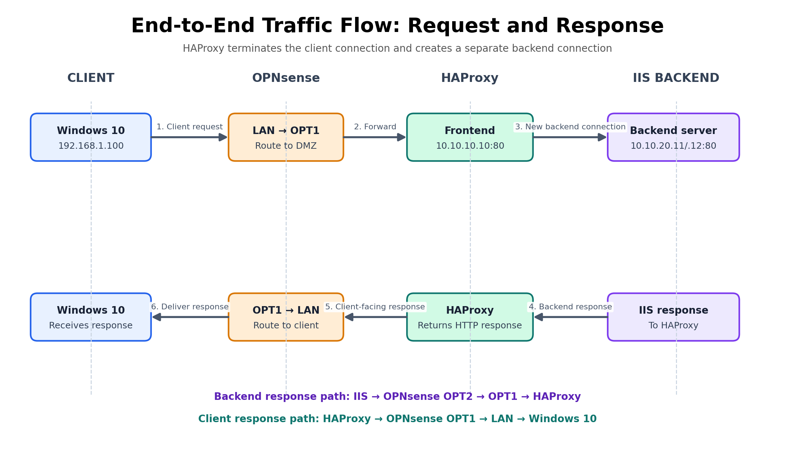

# Building a Segmented Reverse Proxy and Load Balancing Architecture Using OPNsense, HAProxy and IIS

### 1. Introduction

In an enterprise environment, hosting multiple web servers behind a reverse proxy and load balancer provides better availability, scalability, security, and traffic management.

In this lab, we will build a segmented network architecture using:

* **OPNsense:** Network firewall, gateway, and inter-network routing.
* **HAProxy:** Reverse proxy and HTTP load balancer.
* **IIS01 and IIS02:** Backend web servers hosting the website.
* **Windows 10:** Client machine used to access and test the application.

The main objective is to ensure that all communication between the client, reverse proxy, and backend servers passes through OPNsense.

Rather than connecting HAProxy and IIS servers directly to the same network, we will place them in separate network segments. This allows OPNsense to inspect and enforce firewall policies on both frontend and backend connections.

### 2. Network Architecture Overview

The architecture consists of three separate network zones:

1. **LAN:** Client and management network.
2. **DMZ:** HAProxy reverse proxy network.
3. **Backend Network:** Internal IIS web server network.

Each network segment has its own gateway interface on OPNsense.

#### Network Architecture Diagram


<figure><figcaption></figcaption></figure>

**Architecture principle:** OPNsense routes traffic between the network zones, while HAProxy makes the backend selection and distributes incoming requests.

### 3. Network IP Address Planning

Before configuring the virtual machines, define the IP addressing scheme.

| Component      | Interface / Role | IP address       |
| -------------- | ---------------- | ---------------- |
| OPNsense       | LAN              | 192.168.1.1/24   |
| OPNsense       | OPT1 - DMZ       | 10.10.10.1/24    |
| OPNsense       | OPT2 - Backend   | 10.10.20.1/24    |
| Windows 10     | Client           | 192.168.1.100/24 |
| Ubuntu HAProxy | Reverse Proxy    | 10.10.10.10/24   |
| IIS01          | Backend Server 1 | 10.10.20.11/24   |
| IIS02          | Backend Server 2 | 10.10.20.12/24   |

#### Default Gateway Configuration

The default gateway of each machine must point to its local OPNsense interface.

| Machine        | Default Gateway |
| -------------- | --------------- |
| Windows 10     | 192.168.1.1     |
| Ubuntu HAProxy | 10.10.10.1      |
| IIS01          | 10.10.20.1      |
| IIS02          | 10.10.20.1      |

This gateway configuration ensures that traffic destined for a different subnet is sent to OPNsense.

_Note: These are proposed lab addresses. Verify existing interfaces, networks, and IP conflicts before applying them._

### 4. VirtualBox Network Adapter Planning

The lab uses VirtualBox Internal Networks to isolate the different network zones.

#### OPNsense Network Adapters

| VirtualBox Adapter | Network              | Purpose                      |
| ------------------ | -------------------- | ---------------------------- |
| Adapter 1          | Existing WAN network | Internet connectivity        |
| Adapter 2          | Existing LAN network | Client and management access |
| Adapter 3          | Existing DMZ network | HAProxy connectivity         |
| Adapter 4          | CDN-BACKEND          | IIS backend connectivity     |

The existing WAN, LAN, and OPT1 assignments must remain unchanged. Adapter 4 is added for the new backend network and assigned as OPT2 inside OPNsense.

#### HAProxy Network Adapter

| Adapter   | Network | IP          |
| --------- | ------- | ----------- |
| Adapter 1 | CDN-DMZ | 10.10.10.10 |

HAProxy requires only one network adapter in this architecture.

#### IIS Network Adapters

| Server | Adapter   | Network     | IP          |
| ------ | --------- | ----------- | ----------- |
| IIS01  | Adapter 1 | CDN-BACKEND | 10.10.20.11 |
| IIS02  | Adapter 1 | CDN-BACKEND | 10.10.20.12 |

Both IIS servers connect to the backend network.

#### VirtualBox Network Topology

<figure><figcaption></figcaption></figure>

**Important:** Do not change existing OPNsense adapter assignments without first confirming which VirtualBox adapter corresponds to WAN, LAN, and OPT1. Moving an IIS VM to a different network can also interrupt RDP access, so establish a management access plan first.

### 5. Understanding the Role of Each Network Zone

#### 5.1 LAN Network

The LAN network contains the client machine and administrative systems.

Its responsibilities include:

* Accessing the web application.
* Managing network infrastructure.
* Accessing approved internal services.
* Testing reverse proxy and load balancing.

The LAN should not have unrestricted access to the backend servers.

#### 5.2 DMZ Network

The DMZ contains the HAProxy reverse proxy.

HAProxy acts as the entry point for application traffic.

Its responsibilities include:

* Accepting HTTP/HTTPS connections.
* Forwarding requests to backend web servers.
* Performing load balancing.
* Checking backend health.
* Removing unhealthy servers from the active pool.
* Returning backend responses to clients.

Placing HAProxy in a separate DMZ prevents clients from directly accessing the IIS servers.

#### 5.3 Backend Network

The backend network contains IIS01 and IIS02.

Its responsibilities include:

* Hosting the actual website.
* Processing application requests.
* Returning application responses to HAProxy.
* Providing redundant application hosting.

The backend network should not be directly accessible from untrusted networks.

### 6. How Incoming Traffic Reaches the IIS Servers

Understanding the traffic flow is the most important part of this architecture.

Consider a user opening the following URL:

`http://10.10.10.10`

The request passes through the following stages.

#### Step 1: Client Sends an HTTP Request

The Windows 10 client sends an HTTP request to the HAProxy IP address.

Source:

`192.168.1.100`

Destination:

`10.10.10.10`

Since the destination belongs to another subnet, the client sends the packet to its default gateway:

`192.168.1.1`

#### Step 2: OPNsense Routes Traffic to HAProxy

OPNsense receives the request on its LAN interface.

It checks the applicable firewall rules and routing table.

The destination network is the DMZ network:

`10.10.10.0/24`

OPNsense forwards the traffic through OPT1 to HAProxy.

#### Step 3: HAProxy Receives the Request

HAProxy accepts the incoming HTTP connection on port 80.

It checks its backend configuration and selects an available IIS server.

For example:

* First request: IIS01.
* Second request: IIS02.
* Third request: IIS01.

The selection depends on the configured load-balancing algorithm.

#### Step 4: HAProxy Creates a Backend Connection

HAProxy creates a separate connection to the selected IIS server.

For example:

Source:

`10.10.10.10`

Destination:

`10.10.20.11:80`

Because the destination is on a different subnet, HAProxy forwards the packet to its default gateway:

`10.10.10.1`

This is OPNsense OPT1.

#### Step 5: OPNsense Routes Traffic to the Backend

OPNsense receives the backend connection on OPT1.

It checks the firewall policy and routes the packet through OPT2.

The packet reaches IIS01 on the backend network.

The same process applies when HAProxy selects IIS02.

#### Incoming Traffic Flow Diagram

<figure><figcaption></figcaption></figure>

### 7. How OPNsense Inspects Backend Traffic

A common question is: If traffic already reaches HAProxy through OPNsense, why do we need OPT2?

The answer is network segmentation and routing.

HAProxy and IIS servers are deliberately placed in different subnets.

HAProxy belongs to:

`10.10.10.0/24`

IIS servers belong to:

`10.10.20.0/24`

When HAProxy tries to reach IIS01, it cannot communicate directly at Layer 2 because IIS01 is outside its local subnet.

It must send the packet to its default gateway.

That gateway is OPNsense.

OPNsense receives the connection on OPT1, evaluates the firewall rules, and forwards it through OPT2.

Therefore, OPNsense sees and controls the backend connection as well as the frontend connection.

#### Backend Routing Diagram

<figure><figcaption></figcaption></figure>

**Important:** OPT2 does not independently inspect all network traffic. It is the backend-facing interface through which OPNsense forwards traffic. The firewall processes routed packets and applies its stateful filtering policies.

### 8. How Return Traffic Travels from IIS to the Client

The response path is equally important.

IIS does not directly respond to the original Windows 10 client.

It responds to HAProxy because HAProxy established the backend connection.

For example, IIS01 receives a request from:

`10.10.10.10`

IIS01 generates the response and sends it to:

`10.10.10.10`

Since HAProxy belongs to a different subnet, IIS01 sends the response to its default gateway:

`10.10.20.1`

That is OPNsense OPT2.

OPNsense routes the response through OPT1 to HAProxy.

HAProxy then returns the application response over the client-facing connection.

The response travels from HAProxy through OPNsense to the Windows 10 client.

#### Return Traffic Diagram

<figure><figcaption></figcaption></figure>

OPNsense is stateful, so return traffic belonging to an allowed connection is normally permitted automatically. HAProxy then sends the response using its separate client-facing connection.

### 9. HAProxy Load Balancing Configuration

After completing network connectivity and firewall configuration, install HAProxy on Ubuntu.

The following example configures an HTTP frontend and a round-robin backend.

#### HAProxy Configuration

Edit:

`/etc/haproxy/haproxy.cfg`

```
frontend http_frontend
    bind *:80
    mode http
    default_backend iis_web_servers

backend iis_web_servers
    mode http
    balance roundrobin

    option httpchk GET /
    http-check expect status 200

    server IIS01 10.10.20.11:80 check
    server IIS02 10.10.20.12:80 check
```

#### Configuration Explanation

| Directive                | Purpose                             |
| ------------------------ | ----------------------------------- |
| `frontend http_frontend` | Defines the client-facing frontend  |
| `bind *:80`              | Listens on HTTP port 80             |
| `mode http`              | Enables HTTP processing             |
| `default_backend`        | Selects the backend pool            |
| `balance roundrobin`     | Distributes connections in rotation |
| `option httpchk GET /`   | Sends HTTP health checks            |
| `server IIS01`           | Defines the first backend           |
| `server IIS02`           | Defines the second backend          |
| `check`                  | Enables backend health monitoring   |

Validate the configuration and restart HAProxy:

```
sudo haproxy -c -f /etc/haproxy/haproxy.cfg
sudo systemctl restart haproxy
sudo systemctl status haproxy
```

The health-check endpoint must return the expected HTTP status. If your application returns a redirect or another status code, adjust the health-check expectation accordingly.

### 10. OPNsense Firewall Rule Planning

Firewall rules should be based on least privilege.

The objective is to permit only the connections required for the application.

#### LAN Firewall Rules

| Source               | Destination | Port    | Action                         |
| -------------------- | ----------- | ------- | ------------------------------ |
| Approved LAN clients | HAProxy     | TCP 80  | Allow                          |
| Approved LAN clients | HAProxy     | TCP 443 | Allow when HTTPS is configured |

#### OPT1 Firewall Rules

| Source  | Destination | Port   | Action |
| ------- | ----------- | ------ | ------ |
| HAProxy | IIS01       | TCP 80 | Allow  |
| HAProxy | IIS02       | TCP 80 | Allow  |

These rules permit HAProxy to communicate with the backend web servers.

#### OPT2 Firewall Rules

| Source                           | Destination     | Port     | Action                   |
| -------------------------------- | --------------- | -------- | ------------------------ |
| Approved LAN administration host | IIS01           | TCP 3389 | Allow if RDP is required |
| Approved LAN administration host | IIS02           | TCP 3389 | Allow if RDP is required |
| Other unapproved sources         | Backend network | Any      | Deny                     |

The RDP rules should only be added if required, with the source restricted to an approved management host or subnet.

OPNsense interface rules are evaluated on the interface where the traffic enters. Therefore, the HAProxy-to-IIS connection is filtered by the OPT1 rules, not by an independently applied OPT2 ingress rule.

Stateful return traffic is normally allowed automatically for permitted connections.

### 11. Testing the Architecture

After configuring the network adapters, IP addresses, gateways, firewall rules, and HAProxy, perform the following tests.

#### Test 1: Verify HAProxy Network Configuration

On Ubuntu:

```
ip -br addr
ip route
```

Confirm:

* HAProxy has IP `10.10.10.10`.
* Default gateway is `10.10.10.1`.

#### Test 2: Test Backend Connectivity

From Ubuntu:

```
curl -I http://10.10.20.11
curl -I http://10.10.20.12
```

Both IIS servers should return the expected HTTP response.

#### Test 3: Test Frontend Access

From Windows 10:

```
Test-NetConnection 10.10.10.10 -Port 80
```

Then open:

`http://10.10.10.10`

The request should reach the application through HAProxy.

#### Test 4: Test Load Balancing

Configure IIS01 and IIS02 to display different identifying content.

For example:

* IIS01: `Welcome to IIS Server 01`
* IIS02: `Welcome to IIS Server 02`

Send multiple HTTP requests:

```
for i in {1..10}; do
    curl -s http://10.10.10.10
    echo
done
```

With suitable test content and a new backend connection for each request, you should observe responses from both servers.

#### Test 5: Test Backend Failover

1. Stop the IIS website or IIS service on IIS01.
2. Wait for HAProxy to detect the failed health check.
3. Send new requests to HAProxy.
4. Verify that IIS02 continues responding.
5. Restore IIS01.
6. Confirm that HAProxy marks IIS01 healthy again.

Existing client connections are not necessarily migrated when a backend fails. Failover applies to new eligible requests or connections.

### 12. Monitoring and Troubleshooting

The following locations help troubleshoot the architecture.

| Component     | Monitoring / Troubleshooting |
| ------------- | ---------------------------- |
| OPNsense      | Firewall Live View           |
| OPNsense      | Firewall States              |
| OPNsense      | Interfaces Overview          |
| Ubuntu        | `ip route`                   |
| Ubuntu        | `systemctl status haproxy`   |
| Ubuntu        | HAProxy logs                 |
| IIS01 / IIS02 | IIS access logs              |
| IIS01 / IIS02 | Windows Firewall logs        |
| Windows 10    | `Test-NetConnection`         |

To inspect traffic on OPNsense, use packet capture on:

* LAN: Client-to-HAProxy traffic.
* OPT1: HAProxy-facing and backend-routed traffic.
* OPT2: Backend server traffic.

For example, when HAProxy connects to IIS01, you should be able to observe the packet entering OPT1 and leaving OPT2.

### 13. Security Considerations and Future Enhancements

Once the basic lab works, it can be extended into a more realistic enterprise architecture.

Potential improvements include:

1. **HTTPS termination:** Configure TLS certificates on HAProxy.
2. **Cloudflare integration:** Place Cloudflare in front of the origin infrastructure for DNS proxying, CDN caching, and edge WAF protection.
3. **Web Application Firewall:** Evaluate ModSecurity with OWASP Core Rule Set for application-layer protection.
4. **Network IDS/IPS:** Configure Suricata on OPNsense where supported and appropriate.
5. **HAProxy monitoring:** Enable the HAProxy statistics page with restricted administrative access.
6. **Centralized logging:** Forward firewall, proxy, and IIS logs to a centralized monitoring platform.
7. **High availability:** Add a second HAProxy instance and investigate CARP/VRRP-based failover.
8. **Backend TLS:** Use HTTPS between HAProxy and IIS when required by the security design.

OPNsense provides network-layer firewalling and routing. It should not be confused with a full HTTP WAF. Cloudflare WAF or a dedicated application-layer WAF provides that additional protection.

### 14. Final Architecture Summary

The completed architecture separates network security, traffic distribution, and application hosting into dedicated components.

| Layer            | Component  | Responsibility                                        |
| ---------------- | ---------- | ----------------------------------------------------- |
| Client           | Windows 10 | Accesses the website                                  |
| Network Security | OPNsense   | Routing, firewall filtering, and network segmentation |
| Reverse Proxy    | HAProxy    | Accepts and forwards HTTP/HTTPS requests              |
| Load Balancing   | HAProxy    | Distributes traffic and monitors backend health       |
| Application      | IIS01      | Hosts the website                                     |
| Application      | IIS02      | Hosts a redundant copy of the website                 |

#### Final Traffic Flow

**Incoming:**

Windows 10 → OPNsense LAN → OPNsense OPT1 → HAProxy → OPNsense OPT1 → OPNsense OPT2 → IIS01 / IIS02

**Return:**

IIS01 / IIS02 → OPNsense OPT2 → OPNsense OPT1 → HAProxy → OPNsense OPT1 → OPNsense LAN → Windows 10

The two connections handled by HAProxy are separate TCP connections. The backend response returns to HAProxy, and HAProxy sends the client-facing response over the original frontend connection.

This design demonstrates how a segmented reverse-proxy architecture works in practice, including firewall inspection, inter-subnet routing, load balancing, health checks, and backend failover.

***

**Conclusion**

This lab provides a practical foundation for understanding enterprise reverse-proxy and load-balancing environments.

The most important design decision is keeping HAProxy and IIS servers in separate network segments. By doing so, OPNsense becomes the routing and security enforcement point for both frontend and backend communication, while HAProxy remains responsible for application traffic distribution.
